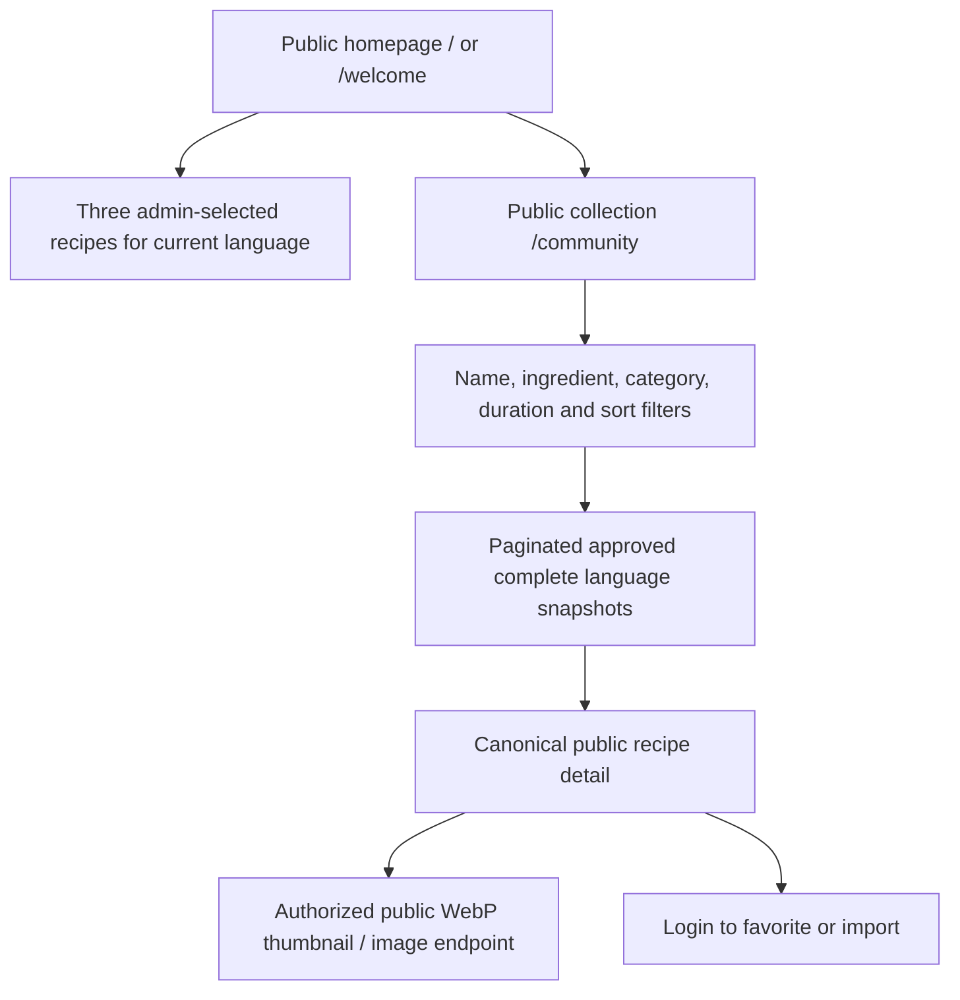
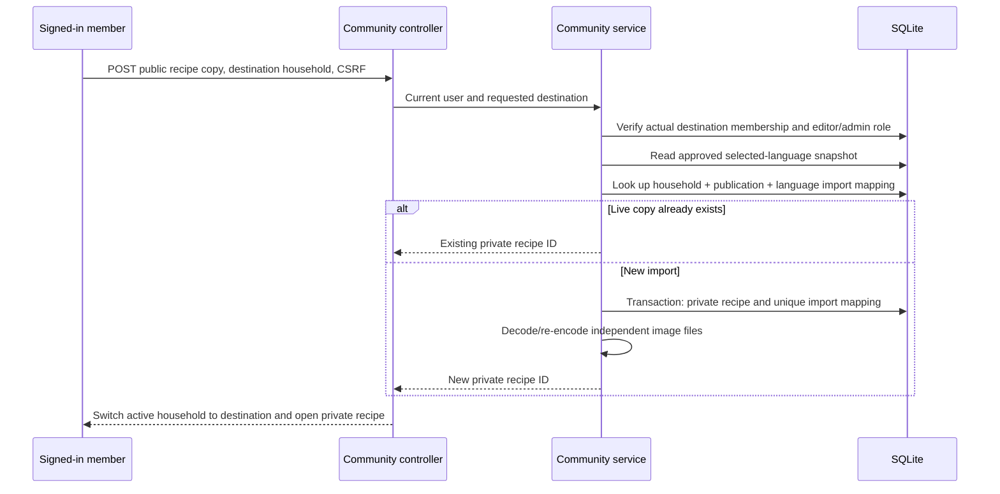

# Implemented application flows

The app remains a modular Express/EJS monolith. Routes enforce authentication, CSRF and role gates; services enforce data ownership, publication visibility and validation. SQLite/Drizzle persist data; uploads live outside the public root. Existing recipe editing, serving scaling, favorites, comments, household roles, multilingual approval, planner and account management are reused.

## Public discovery

The homepage is public even when signed in. My kitchen returns to `/kitchen`. Feature configuration requires exactly three distinct approved recipes per language; unpublishing removes that recipe from the slots immediately. Until an administrator supplies a replacement, fewer slots are displayed, rather than exposing unpublished content or fabricating recipes. Public content never falls back to another language. Directory filters are server-side and pagination is applied in SQL. Unknown metadata is omitted from structured data. Existing canonical URLs, hreflang, JSON-LD, robots and sitemap services remain in use.

## Private recipe creation and cooking

Authenticated editor/admin opens `/recipes/new`, enters structured ingredients and ordered steps, previews and saves a draft or published private recipe. The recipe belongs to the active household; only its author with an editor/admin membership can edit/delete it. Members can read, favorite, comment and keep personal notes. Uploads are validated by actual image decoding and converted to generated WebP files and thumbnails. Cooking mode and serving changes affect browser presentation, not original quantities. The weekly planner uses existing recipe/public references and serving counts. Shopping lists remain deferred.

## Independent public-to-private import

The new recipe retains source attribution, structured quantities, steps and categories. Personal notes start empty. Public edits and withdrawals never propagate into the private copy; private edits/deletion never modify the public snapshot. Failed image imports remove the newly created recipe and files. Removing a private recipe cascades its import mapping, allowing later reimport. Importing different approved languages intentionally creates separate copies. The combined collection hides a public counterpart when its tracked private copy matches the active filters; public-only browsing remains unchanged. Existing imports made before migration 0009 cannot reliably be backfilled and are not matched by title.

## Dedicated suggestion and moderation

```mermaid
flowchart TD
  A[Signed-in user: Suggest a recipe] --> B[Dedicated form, structured ingredients and ordered steps]
  B --> C[POST /suggestions, CSRF and rate limit]
  C --> D[Independent publication envelope, pending language snapshot]
  D --> E[My submissions: feedback and status]
  D --> F[Super Admin public recipes queue]
  F --> G[Review and edit public snapshot, categories and images]
  G --> H{Decision}
  H -->|Approve and publish| I[Public directory and sitemap]
  H -->|Reject with reason| E
  H -->|Save draft or unpublish| J[Hidden from public readers and featured slots]
```

New public admin recipes and dedicated suggestions have no household ownership, so workspace deletion cannot discard them. Dedicated suggestions have no private `recipe_id`; their snapshot flag identifies them separately from legacy source-linked submissions. They create no private recipe and include no personal notes/comments. Any signed-in account can suggest, including read-only members and accounts without an active household. The submitting user can inspect their own dedicated suggestion; other households cannot. Legacy pending submissions and moderator review routes remain for backward compatibility, but the personal profile no longer offers direct source-recipe submission controls. No member action publishes without approval.

Super Admin public editing is separate from workspace administration at `/super-admin/public-recipes`. It creates public-only drafts or approved recipes, edits pending suggestions, approves/rejects and unpublishes language versions. Service methods re-read the Super Admin flag from the users table, even when invoked outside HTTP routes. A version hash rejects stale forms and image operations with HTTP 409 instead of overwriting another edit. Existing content language is fixed in the form; the interface language does not silently change it. Category IDs come from the existing global catalog. The original envelope and language snapshot are synchronized for original-language content, preserving compatibility with existing publication services.

Image upload uses existing validation rules, generated names, WebP optimization and external storage. The first image is the cover; deleting it promotes the next image. File cleanup checks all snapshots before deleting a shared translation image. Private imports always own separate image files.

## Featured recipes

Super Admin opens the public-recipe manager in a chosen interface language, selects three different approved recipes in slots 1–3, and saves the set transactionally. Invalid or incomplete selections fail without modifying the previous configuration. Homepage order follows those slots; no random/latest fallback replaces the administrator's selection. Repeat for EN/DE after approving recipes in those languages.

## Safe migration and library seed

1. Stop the server and create a matched database/upload backup using the existing backup guide.
2. Run `npm run db:migrate`. Migration 0009 adds only import mappings, feature slots and seed keys; it does not rewrite existing recipe or account rows.
3. Run `npm run build`, then start the server.
4. Optionally run `npm run seed:public -- --admin-email=you@example.com`. The named account must already be Super Admin. Twelve original Slovenian starter recipes are added as drafts.
5. Review drafts in the public manager and publish them individually, or explicitly add `--publish` to the initial seed command to approve the new entries immediately.
6. Choose the homepage's three featured recipes in the public manager.

The seed applies all additions in one transaction, skips existing versioned keys and matching Slovenian titles, does not create/elevate users, does not overwrite existing recipes and does not fetch images. Rerunning with `--publish` does not publish drafts already inserted by a previous run; use the admin UI to change existing entries. EN/DE stay empty until actual approved translations exist. Real development/production data is not used by automated tests.

## Scope and limits

Invitation-only registration, existing moderator tools and multilingual private-recipe translations are preserved. Suggestions use public snapshot JSON for ingredient/step order, while private recipes retain normalized ingredient/step tables. There is no background synchronization between copies, automatic translation, public signup, shopping list, scheduled automation or external image service. The test suites exercise representative flows and mobile widths; they are not a complete accessibility or multi-browser certification.

## Verification (19 November 2026)

`npm test` passed 73 tests. `npm run build`, `npm run test:browser`, `npm run test:browser:i18n` and `npm run test:browser:library` passed. The library browser suite covers admin and member workflows at 1440/390/320px; the multilingual suite includes the new forms in EN/DE. The new server regression covers database-backed role enforcement, pending/approved/rejected/draft states, isolated duplicate-safe copies, original attribution, image content validation/deletion and independent image copies, featured ordering, language isolation, CSRF and repeated migration/seed execution. Mobile editor screenshots were inspected. No development database migration or seed was run; follow the safe migration steps above before starting this version against existing data.
