# Database relationships

The diagram includes every Drizzle table and declared foreign key. Optional references use zero-or-one cardinality. Composite primary keys are marked on each participating field. Audit target IDs intentionally have no FK so deletion history survives. Sessions contain serialized server-side session data rather than a direct user FK.

```mermaid
erDiagram
    audit_events {
        integer id PK
        integer actor_id FK
        text action
        integer workspace_id
        integer target_user_id
        text created_at
    }
    categories {
        integer id PK
        integer household_id FK
        text name
        text normalized_name
    }
    community_favorites {
        integer user_id PK,FK
        integer publication_id PK,FK
    }
    favorites {
        integer user_id PK,FK
        integer recipe_id PK,FK
    }
    featured_recipes {
        text language PK
        integer position PK
        integer publication_id FK
    }
    file_deletions {
        text filename PK
        text created_at
    }
    global_categories {
        integer id PK
        text key
        integer active
    }
    global_category_names {
        integer category_id PK,FK
        text language PK
        text name
    }
    global_ingredient_names {
        integer ingredient_id PK,FK
        text language PK
        text name
    }
    global_ingredients {
        integer id PK
        text key
    }
    household_members {
        integer user_id PK,FK
        integer household_id PK,FK
        text role
    }
    households {
        integer id PK
        text name
        text planner_meals
        text created_at
    }
    ingredient_aliases {
        integer id PK
        integer ingredient_id FK
        text language
        text name
        text normalized_name
    }
    ingredients {
        integer id PK
        integer household_id FK
        text name
        text normalized_name
    }
    invitations {
        integer id PK
        text token_hash
        text email
        integer household_id FK
        text role
        integer created_by FK
        integer expires_at
        text used_at
        text revoked_at
        text created_at
    }
    meal_plan_entries {
        text source_kind
        integer id PK
        integer household_id FK
        text date
        text slot
        integer recipe_id FK
        integer publication_id FK
        text title_snapshot
        integer servings
        text revision
        integer updated_by FK
        text created_at
        text updated_at
    }
    public_imports {
        integer household_id PK,FK
        integer publication_id PK,FK
        text language PK
        integer recipe_id FK
    }
    public_seed_entries {
        text key PK
        integer publication_id FK
    }
    publication_categories {
        integer publication_id PK,FK
        integer category_id PK,FK
    }
    publication_translations {
        integer id PK
        integer publication_id FK
        text language
        text status
        integer complete
        text snapshot
        text feedback
        text created_at
        text reviewed_at
        integer reviewed_by FK
    }
    recipe_categories {
        integer recipe_id PK,FK
        integer category_id PK,FK
    }
    recipe_comments {
        integer id PK
        integer recipe_id FK
        integer user_id FK
        text body
        text created_at
    }
    recipe_images {
        integer id PK
        integer recipe_id FK
        text filename
        text thumbnail
        integer position
    }
    recipe_ingredients {
        integer canonical_ingredient_id FK
        integer id PK
        integer recipe_id FK
        integer ingredient_id FK
        text name
        text quantity
        text unit
        text note
        integer position
    }
    recipe_notes {
        integer user_id PK,FK
        integer recipe_id PK,FK
        text body
    }
    recipe_publications {
        integer id PK
        integer recipe_id FK
        integer household_id FK
        integer submitted_by FK
        text status
        text snapshot
        text feedback
        text created_at
        text reviewed_at
        integer reviewed_by FK
    }
    recipe_reads {
        integer id PK
        integer user_id FK
        integer recipe_id FK
        integer publication_id FK
        text day
    }
    recipe_steps {
        integer id PK
        integer recipe_id FK
        text body
        integer position
    }
    recipe_translations {
        integer id PK
        integer recipe_id FK
        text language
        text title
        text description
        integer revision
        integer reviewed
        text updated_at
    }
    recipes {
        text original_language
        integer content_revision
        integer id PK
        integer household_id FK
        text title
        text description
        integer prep_minutes
        integer cook_minutes
        integer servings
        text source_type
        text source_url
        text source_description
        text status
        integer created_by FK
        text created_at
        text updated_at
    }
    sessions {
        text sid PK
        text data
        integer expires
    }
    translated_ingredients {
        integer translation_id PK,FK
        integer ingredient_id PK,FK
        text name
        text note
    }
    translated_steps {
        integer translation_id PK,FK
        integer step_id PK,FK
        text body
    }
    users {
        text language
        integer id PK
        text name
        text email
        text password_hash
        integer is_moderator
        integer is_super_admin
        integer session_version
        text created_at
    }
    users ||--o{ audit_events : "actor_id"
    households ||--o{ categories : "household_id"
    users ||--o{ community_favorites : "user_id"
    recipe_publications ||--o{ community_favorites : "publication_id"
    users ||--o{ favorites : "user_id"
    recipes ||--o{ favorites : "recipe_id"
    recipe_publications ||--o{ featured_recipes : "publication_id"
    global_categories ||--o{ global_category_names : "category_id"
    global_ingredients ||--o{ global_ingredient_names : "ingredient_id"
    users ||--o{ household_members : "user_id"
    households ||--o{ household_members : "household_id"
    global_ingredients ||--o{ ingredient_aliases : "ingredient_id"
    households ||--o{ ingredients : "household_id"
    households |o--o{ invitations : "household_id"
    users ||--o{ invitations : "created_by"
    households ||--o{ meal_plan_entries : "household_id"
    recipes |o--o{ meal_plan_entries : "recipe_id"
    recipe_publications |o--o{ meal_plan_entries : "publication_id"
    users ||--o{ meal_plan_entries : "updated_by"
    households ||--o{ public_imports : "household_id"
    recipe_publications ||--o{ public_imports : "publication_id"
    recipes ||--o{ public_imports : "recipe_id"
    recipe_publications ||--o{ public_seed_entries : "publication_id"
    recipe_publications ||--o{ publication_categories : "publication_id"
    global_categories ||--o{ publication_categories : "category_id"
    recipe_publications ||--o{ publication_translations : "publication_id"
    users |o--o{ publication_translations : "reviewed_by"
    recipes ||--o{ recipe_categories : "recipe_id"
    categories ||--o{ recipe_categories : "category_id"
    recipes ||--o{ recipe_comments : "recipe_id"
    users ||--o{ recipe_comments : "user_id"
    recipes ||--o{ recipe_images : "recipe_id"
    global_ingredients |o--o{ recipe_ingredients : "canonical_ingredient_id"
    recipes ||--o{ recipe_ingredients : "recipe_id"
    ingredients |o--o{ recipe_ingredients : "ingredient_id"
    users ||--o{ recipe_notes : "user_id"
    recipes ||--o{ recipe_notes : "recipe_id"
    recipes |o--o{ recipe_publications : "recipe_id"
    households |o--o{ recipe_publications : "household_id"
    users ||--o{ recipe_publications : "submitted_by"
    users |o--o{ recipe_publications : "reviewed_by"
    users ||--o{ recipe_reads : "user_id"
    recipes |o--o{ recipe_reads : "recipe_id"
    recipe_publications |o--o{ recipe_reads : "publication_id"
    recipes ||--o{ recipe_steps : "recipe_id"
    recipes ||--o{ recipe_translations : "recipe_id"
    households ||--o{ recipes : "household_id"
    users ||--o{ recipes : "created_by"
    recipe_translations ||--o{ translated_ingredients : "translation_id"
    recipe_ingredients ||--o{ translated_ingredients : "ingredient_id"
    recipe_translations ||--o{ translated_steps : "translation_id"
    recipe_steps ||--o{ translated_steps : "step_id"
```

Public snapshot images reference generated WebP filenames in filesystem storage, not blobs or private image IDs. Cleanup checks private rows, the original envelope snapshot and all language snapshots before removing files. Language snapshot images may share files across translations; private imports get independent optimized files.
